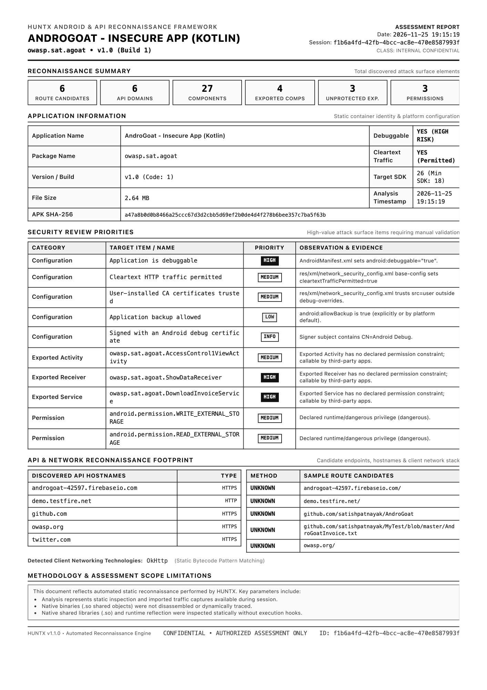

# HUNTX

[](https://www.python.org/)
[](LICENSE)

HUNTX is a passive, offline reconnaissance tool for Android apps. Give it an
APK, XAPK or APKS file and it maps the attack surface: components, permissions,
signers, hosts, API endpoints, and the classes that call them.

It never contacts the app's servers, runs the app, or sends your data anywhere.
No Java, apktool or aapt is needed.

## Install

```bash
git clone https://github.com/TALYAJI/Huntx.git huntx && cd huntx
python3 -m venv .venv && source .venv/bin/activate   # Windows: .venv\Scripts\activate
pip install .
huntx doctor
```

On Linux and macOS `./huntx.sh` does all of this on first run.

## Use

```bash
huntx scan app.apk                        # or .xapk, .apks, a folder, a target name
huntx scan app.apk --burp burp.xml --har capture.har
huntx scan app.apk --raw --open           # keep SDK noise, open the summary
huntx                                     # interactive menu
```

| Command | Purpose |
|---|---|
| `scan` | Run the full analysis and write all reports |
| `targets`, `apks <target>` | List workspaces and packages |
| `surface <target>` | Attack surface tree |
| `search <target> <text>` | Search the collected evidence |
| `notes <target> [--add TEXT]`, `timeline <target>` | Research notes and history |
| `diff <run-or-target> <run-or-target>` | Compare two runs |
| `report <target>` | Rebuild reports from stored evidence |
| `doctor`, `--version` | Diagnostics |

Workspaces live in `Target/` in a checkout and `~/.huntx/targets` when installed.
Set `HUNTX_TARGETS`, or `target_base` in `~/.huntx/config.json`, to change that.

## What you get

Every scan writes a `RUN_<timestamp>/` folder:

| Path | Contents |
|---|---|
| `reports/huntx-summary.html` | One-page printable summary |
| `reports/huntx-report.html` | Interactive inventory, fully offline |
| `reports/*.json`, `reports/*.csv` | Machine-readable results |
| `exports/` | OpenAPI and Postman files, wordlists, deep links, ADB commands, candidate secrets |
| `android/`, `api/`, `mapping/`, `traffic/` | Raw evidence behind each finding |

Sample printable PDF reports (OWASP AndroGoat):
- [Executive summary (A4 PDF)](examples/androgoat/huntx-summary.pdf)
- [Full reconnaissance inventory (PDF)](examples/androgoat/huntx-report.pdf)

[](examples/androgoat/huntx-summary.pdf)

## How it works

- **Manifest and resources.** Pure-Python AXML and `resources.arsc` parsing,
  including obfuscated attribute names and split deep-link patterns.
- **Signing.** v1, v2 and v3 scheme detection with the real X.509 certificates.
- **Endpoints.** Retrofit annotations read directly from DEX give confirmed verbs,
  paths and parameters. URL and path strings give candidates, and OkHttp,
  HttpURLConnection and Apache calls in the same method give inferred verbs.
- **Attribution.** An endpoint is tied to a class only when that class holds the
  matching path. A shared hostname is not treated as evidence.
- **Traffic.** Burp XML and HAR imports are merged with static findings.
  Credentials in headers, URLs and bodies are redacted before anything is stored.

## Limits

- Findings are leads, not vulnerabilities. Verify them by hand.
- Routes assembled at runtime, native code and encrypted strings are not recovered.
- Retrofit detection needs unrenamed `retrofit2.http` annotations.
- HUNTX lists signature schemes and signers. It does not verify signatures.
- `exports/secrets.txt` and the reports hold secrets found in the app in clear
  text, so treat a run folder as confidential.

## Develop

```bash
pip install -e ".[dev]"
ruff check . && pytest
```

Analysed apps are treated as hostile input. New code must read archives with
`huntx.core.safezip`, escape report output, and build device commands with `adb_shell`.

## Responsible use

Only analyse apps you own or are authorised to assess. You are responsible for
complying with the law and the terms that apply to you.

## License

[MIT](LICENSE)
